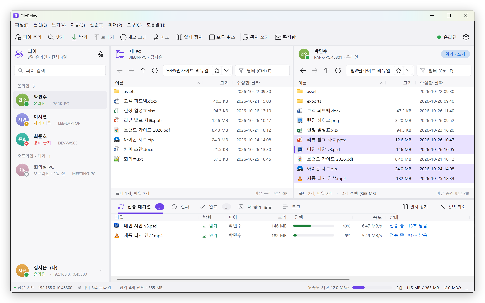
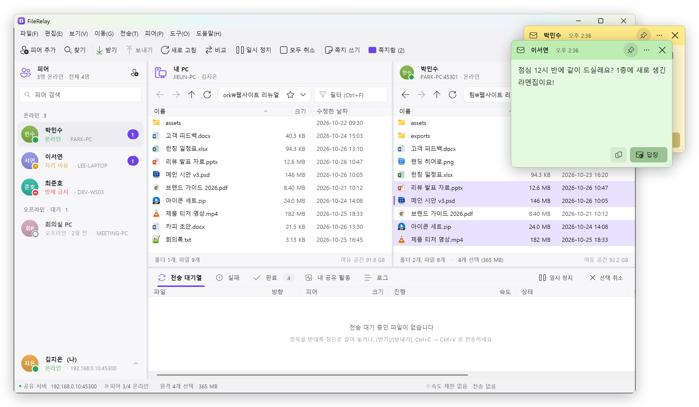
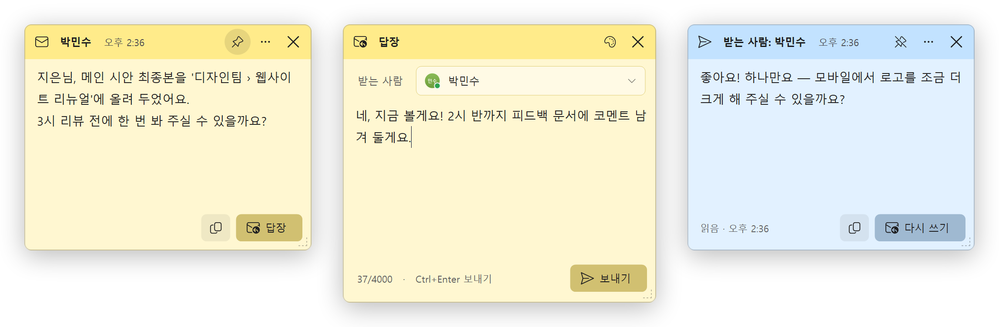
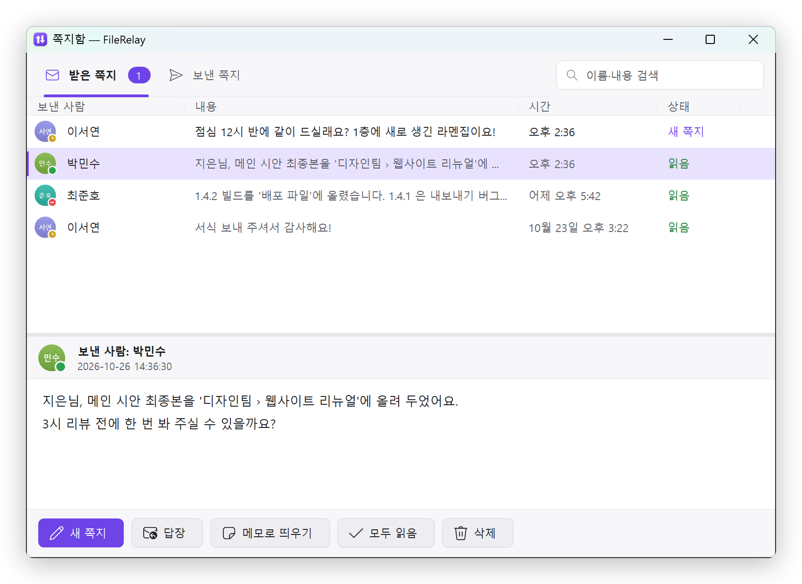
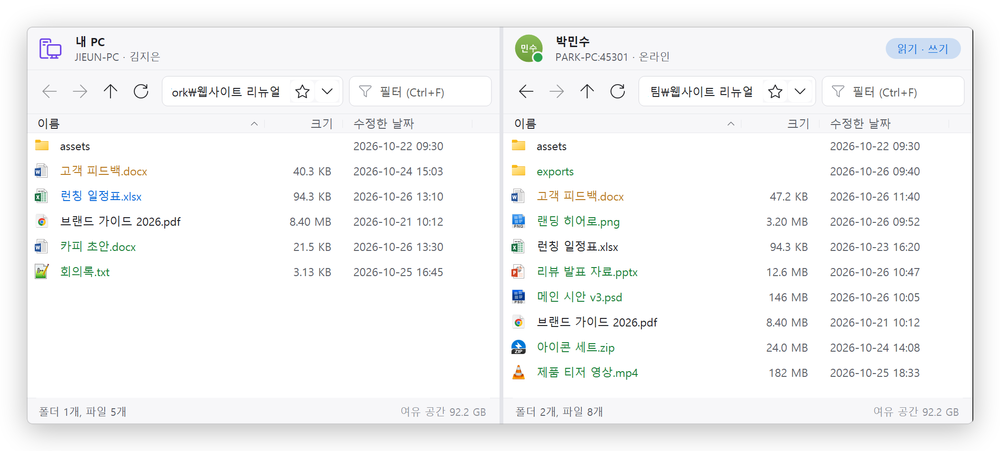
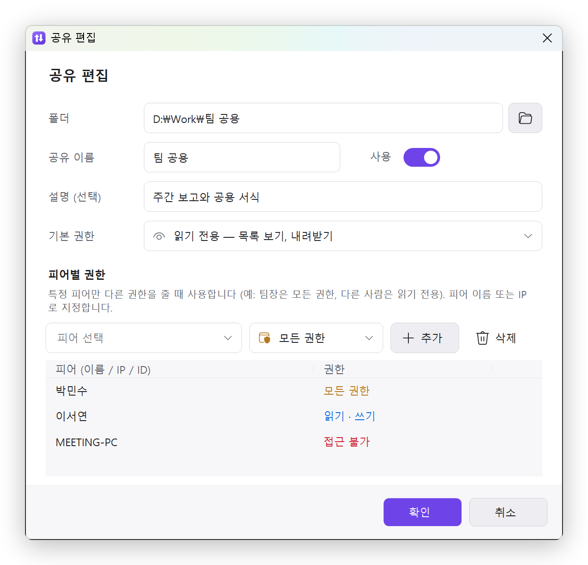
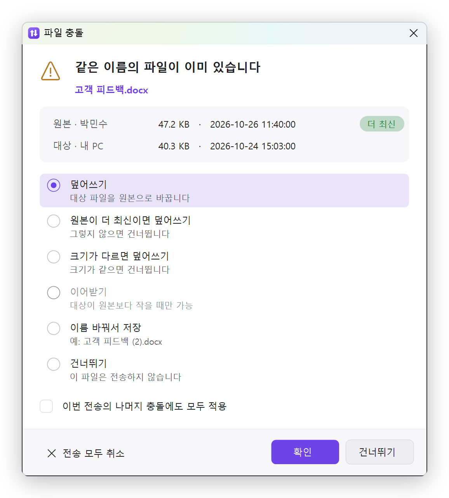
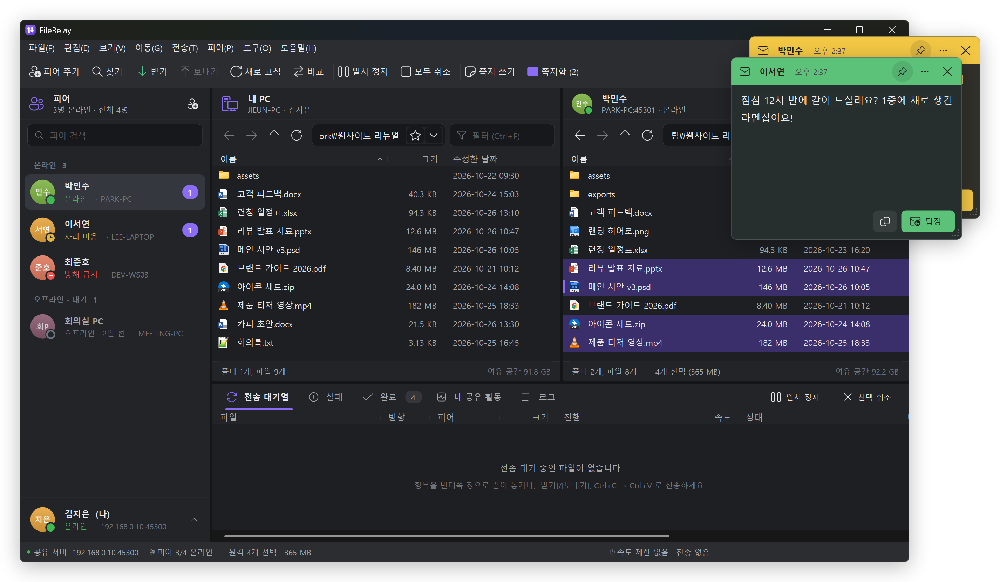

# FileRelay

[English](README.md) | **한국어**

사무실 LAN 에서 PC 끼리 **미리 지정한 공유 폴더**를 HTTP 로 주고받고, **스티커 메모 형식의 쪽지**를 보내는 상주형 도구입니다.
C# WinForms / .NET Framework 4.8, 외부 라이브러리 없이 단일 exe 로 동작합니다 (설치 불필요).

<p align="center">
  
</p>
<p align="center"><sub>왼쪽은 피어 목록, 가운데는 <b>내 PC ↔ 동료의 공유 폴더</b>, 아래는 전송 대기열입니다 (박민수의 <i>디자인팀</i> 공유에서 속도 제한을 걸고 받는 중).</sub></p>

## 주요 기능

| 구분 | 내용 |
|---|---|
| 피어 | IP(또는 PC 이름)로 추가 → 상대도 실행 중이면 **서로 자동 등록**, 상대가 등록한 이름 표시. 상대가 나를 추가하면 트레이 알림과 함께 자동 추가(설정으로 수락 확인 가능). 접속 상태 아이콘(온라인/자리 비움/방해 금지/오프라인/대기/차단), 별칭, 차단, 삭제(양방향), LAN 검색(UDP) |
| 공유 | 공유 폴더 목록을 미리 지정. 권한 단계 `none / read / write / full` + **피어별 권한**. 피어가 삭제·덮어쓴 파일은 내 휴지통으로(복구 가능). 숨김 파일 숨김, 경로 탈출 차단 |
| 전송 | FileZilla 방식 듀얼 창(내 PC ↔ 피어). 대기열·동시 전송·**자동 이어받기/이어 보내기**(`.frpart`), 일시 정지/재개/취소/재시도, 충돌 처리 7가지 + "모두 적용", 속도 제한, 수정 시각 유지, 폴더 재귀 전송, 원격 파일 열기 + 수정 후 다시 올리기, 폴더 비교. 사용자가 직접 할 때만 전송 |
| 탐색 | 뒤로/앞으로/상위(마우스 뒤로·앞으로 버튼 지원), 주소 표시줄, 최근 위치·즐겨찾기, 필터, 자연 정렬, 탐색기 단축키, 끌어서 놓기(탐색기 → 원격 포함), 컨텍스트 메뉴 |
| 쪽지 | 온라인 피어에게 쪽지 → 상대 화면에 **스티커 메모 창**으로 바로 표시(포커스를 뺏지 않음). 답장, 색상, 핀(항상 위), 읽음 확인, 쪽지함(받은/보낸, 검색), 방해 금지 시 보관 후 해제하면 표시 |
| 상주 | 트레이 아이콘(안 읽은 쪽지 배지), Windows 시작 시 실행, 단일 인스턴스, 자동 자리 비움. 창을 닫으면 **트레이에서 계속 실행**(기본)할지 완전히 종료할지 묻습니다 |
| 기록 | 내 공유 활동(누가 무엇을 받고/올리고/지웠는지), 로그 탭 + 일자별 로그 파일 |
| 언어 · 화면 | **한국어 / 영어** (Windows 표시 언어에 따라 자동, 또는 설정에서 선택). 라이트(기본) / 다크 테마 |

## 쪽지

온라인인 동료에게 짧은 메시지를 보냅니다. 대화창이 열리는 메신저가 아니라, 상대 화면에 작은 **스티커 메모**로 붙습니다.

<p align="center">
  
</p>

**보내기**
- 피어를 고르고 **[쪽지 쓰기]**(Ctrl+M), 또는 피어를 오른쪽 클릭 → **[쪽지 보내기…]**, 또는 트레이 메뉴의 **[쪽지 보내기]**.
- 내용을 쓰고 **Ctrl+Enter** 로 보냅니다. 팔레트 버튼으로 색을 바꿀 수 있고, 받는 사람을 **[온라인 피어 모두]** 로 고르면 접속한 모두에게 같은 쪽지를 보냅니다.
- 온라인인 피어에게만 보낼 수 있습니다 (최대 4,000자, 붙여 넣으면 서식 없는 글자만).

**받기**
- 쪽지는 화면 **오른쪽 위에 뜨지만 포커스를 뺏지 않아서** 하던 입력이 끊기지 않습니다. 여러 장이 오면 겹쳐서 쌓입니다.
- 피어 목록의 보낸 사람 옆, **[쪽지함]** 버튼, 트레이 아이콘에 안 읽은 쪽지 수가 표시됩니다.
- **방해 금지** 상태에서는 트레이 알림만 띄우고 보관했다가, 방해 금지를 풀면 그때 띄웁니다.

<p align="center">
  
</p>
<p align="center"><sub>받은 쪽지 → <b>[답장]</b> 을 누르면 같은 색 답장 창이 옆에 열림 → 보낸 쪽 쪽지에 <b>읽음</b> 과 읽은 시각 표시.</sub></p>

**쪽지 창에서**
- **[답장]**(Ctrl+R)은 쪽지 옆에 답장 창을 엽니다. 복사 버튼으로 내용을 복사합니다.
- **핀** 버튼으로 다른 창보다 항상 위에 둘지 정하고, **⋯** 메뉴에서 색 바꾸기, 보낸 사람의 공유 폴더 열기, 쪽지함 열기, 쪽지 창 모두 닫기를 합니다. Esc 로 닫습니다.
- 쪽지를 클릭하거나 닫으면 읽음 처리되고, 보낸 사람의 쪽지에 **읽음** 과 시각이 표시됩니다 (읽음 확인은 끌 수 있음).

**쪽지함**(Ctrl+Shift+M)에는 받은 쪽지와 보낸 쪽지가 모두 남습니다. 이름·내용 검색, 새 쪽지/읽음 상태, 답장, 메모로 다시 띄우기, 모두 읽음, 삭제.

<p align="center">
  
</p>

**[설정 > 쪽지]**: 바로 띄우기(끄면 트레이 알림만), 알림 소리, 항상 위에 표시, 읽음 확인 보내기, 쪽지 창 스타일(파스텔 스티커 메모 / 다크 / 화면 테마에 맞춤), 기본 쪽지 색(7가지), 쪽지함 보관 기간.

## 화면 더 보기

**폴더 비교** — 툴바의 **[비교]** 를 켜면 두 창에서 이름이 같은 항목을 비교해 색으로 표시합니다:
<b>초록</b> = 이쪽에만 있음, <b>주황</b> = 크기 다름, <b>파랑</b> = 이쪽이 더 최신.

<p align="center">
  
</p>

<table>
  <tr>
    <td width="50%" valign="top"><b>피어별 권한</b> — 기본은 읽기 전용이지만 박민수는 모든 권한, 이서연은 올리기까지, 회의실 PC 에는 아예 보이지 않게.</td>
    <td width="50%" valign="top"><b>같은 이름 파일</b> — 크기·날짜를 나란히 보고 7가지 중에서 고르기, "모두 적용" 가능.</td>
  </tr>
  <tr>
    <td></td>
    <td></td>
  </tr>
</table>

**다크 테마** ([설정 > 고급]) — 쪽지 창도 테마를 따라갑니다.

<p align="center">
  
</p>

## 요구 사항

- Windows 10 / 11
- .NET Framework 4.8 (Windows 10 1903 이상 기본 포함)

## 빌드

```
build.cmd
```

또는 `dotnet build src\FileRelay\FileRelay.csproj -c Release`, Visual Studio 2019+ 에서 `FileRelay.sln` 을 열어도 됩니다.
결과물: `src\FileRelay\bin\Release\FileRelay.exe` (이 파일 하나만 배포하면 됩니다).

> 다른 PC 에 줄 때는 **exe 만** 복사하세요. exe 옆의 `FileRelay.jsonc`(설정)와 `FileRelay_data\`(피어 목록·쪽지함·ID)는
> 그 PC 의 것입니다. 1.1.0 부터는 데이터 폴더를 복사해 가도 다른 PC 에서는 새 ID 를 만들지만, 설정의 이름(userName)은 그대로 따라가니 바꿔 주세요.

## 실행

1. `FileRelay.exe` 실행 → 처음에는 **내 이름**, 포트(기본 45200), 첫 공유 폴더(선택), 언어를 묻습니다.
2. 동료 PC 의 IP 를 **[피어 추가]**(Ctrl+N) 에 입력합니다. 상대도 실행 중이면 서로의 목록에 추가됩니다.
   같은 서브넷이면 **[네트워크에서 피어 찾기]** 로 실행 중인 PC 를 고를 수도 있습니다.
3. 왼쪽 피어를 클릭하면 오른쪽 창에 상대의 공유 폴더가 보입니다. 끌어 놓기, [받기]/[보내기], Ctrl+C → Ctrl+V 로 전송합니다.

> **방화벽**: 처음 실행할 때 Windows 방화벽 허용 창이 뜨면 허용하세요. 다른 PC 가 내게 연결하지 못하면
> 상태 표시줄의 경고 또는 **[도구 > Windows 방화벽 허용 규칙 추가]** 를 누르세요(관리자 권한). 프로그램 규칙과 포트(TCP/UDP) 규칙을 모든 네트워크 프로필에 추가합니다.

### 명령줄

| 인자 | 설명 |
|---|---|
| `--tray` | 창 없이 트레이에서 시작 (Windows 시작 시 실행에 사용) |
| `--data <폴더>` | 설정/데이터 폴더 지정 — 한 PC 에서 여러 개를 실행할 때 |

## 설정 파일 (JSONC)

- 위치: exe 폴더에 쓸 수 있으면 exe 옆의 `FileRelay.jsonc` + `FileRelay_data\`(포터블), 아니면 `%APPDATA%\FileRelay\`.
- 주석(`//`, `/* */`)과 끝 쉼표를 쓸 수 있습니다. **설정 창**([파일 > 설정], Ctrl+,)에서 바꾸는 것을 권장하며, 파일을 직접 고쳐 저장해도 실행 중에 자동으로 다시 읽습니다(포트 변경 포함). 언어·테마·글꼴 변경만 다시 시작이 필요합니다.
- 피어 목록·쪽지함·창 상태는 설정 파일이 아니라 데이터 폴더(`peers.json`, `notes.json`, `state.json`, `logs\`)에 저장됩니다.

```jsonc
{
  "userName": "홍길동",
  "port": 45200,
  "language": "auto",        // auto (Windows 표시 언어) | ko | en
  "theme": "light",          // light | dark
  "shares": [
    {
      "name": "팀 공용",
      "path": "D:\\Share\\Team",
      "access": "read",                       // 기본: 읽기 전용
      "peerAccess": { "김철수": "full",         // 이 사람만 모든 권한
                      "192.168.0.15": "none" } // 이 PC 에는 숨김
    }
  ]
}
```

### 공유 권한

| 단계 | 할 수 있는 일 |
|---|---|
| `none` | 해당 피어에게 공유가 보이지 않음 |
| `read` | 목록 보기, 내려받기 |
| `write` | + 올리기(새 파일), 새 폴더, 이어 보내기 — 삭제·덮어쓰기·이름 변경 **불가** ("복사만") |
| `full` | + 삭제, 이름 변경, 덮어쓰기 |

## 번역

화면 문장은 `src/FileRelay/Lang/ko.json`, `en.json` 에 있습니다 (평평한 `"키": "문장"`, exe 에 내장).
다시 빌드하지 않고 번역을 고치려면 exe 옆에 `lang\ko.json`(또는 `en.json`)을 두고 바꿀 키만 적으면 됩니다.
`python tools/i18n_check.py` 는 소스에서 쓰는 키가 두 언어에 모두 있는지, 두 파일의 키와 자리 표시자가 같은지 검사하고 남은 하드코딩 문자열을 보여 줍니다.

## 주요 단축키

| 키 | 동작 |
|---|---|
| Enter / 더블클릭 | 폴더 열기, 파일 열기 (원격 파일은 임시 폴더로 받아 열기) |
| Backspace, Alt+↑ | 상위 폴더 |
| Alt+← / Alt+→, 마우스 뒤로/앞으로 | 뒤로 / 앞으로 |
| F5, Ctrl+R | 새로 고침 |
| Ctrl+L, Alt+D, F4 / Ctrl+F | 주소 표시줄 / 필터 |
| Ctrl+C / Ctrl+V | 복사 / 붙여넣기 (반대쪽 창에 붙이면 전송) |
| Ctrl+T, Ctrl+Enter | 선택 항목을 반대쪽 창으로 전송 |
| F2 / Delete / Ctrl+Shift+N | 이름 바꾸기 / 삭제 / 새 폴더 |
| Tab | 로컬 ↔ 원격 창 전환 |
| Ctrl+N / Ctrl+M / Ctrl+Shift+M | 피어 추가 / 쪽지 쓰기 / 쪽지함 |
| Ctrl+P / Ctrl+, / F1 | 전송 일시 정지 / 설정 / 단축키 도움말 |

## 프로토콜 (유지보수용)

`TcpListener` 기반 HTTP/1.1 서버 (HttpListener 는 외부 바인딩에 관리자 권한이 필요해서 사용하지 않음). 모든 요청에 `X-FR-Id / X-FR-Name / X-FR-Port / X-FR-Status / X-FR-Key(그룹 키 해시)` 헤더를 붙입니다. 오류는 코드와 인자로 보내서 받는 쪽이 자기 언어로 보여 줍니다.

| 메서드 | 경로 | 설명 |
|---|---|---|
| GET | `/api/hello` | 공개 정보 (이름, ID, 포트) |
| POST | `/api/register` · `/api/unregister` · `/api/ping` · `/api/goodbye` | 피어 관계 / 하트비트 |
| GET | `/api/shares` · `/api/list` · `/api/walk` · `/api/stat` | 공유 탐색 (서로 등록된 피어만) |
| GET | `/api/file` (+`Range`) | 내려받기 (이어받기) |
| PUT | `/api/file?offset&total&mode` | 올리기 — `.frpart` 에 쓰고 완료 시 교체 |
| POST | `/api/mkdir` · `/api/rename` · `/api/delete` · `/api/discard` | 파일 작업 (권한 검사) |
| POST | `/api/note` · `/api/note/read` | 쪽지 / 읽음 확인 |

LAN 검색은 같은 포트의 UDP 브로드캐스트(`FRDISC1` / `FRHELLO1`)를 씁니다.

## 테스트

헤드리스 end-to-end 테스트 (노드 두 개를 띄워 페어링, 무결성, 이어받기, 충돌 정책, 권한, 경로 탈출, 일시 정지/취소, 쪽지, ID, 설정 왕복, 두 언어 등을 검사):

```
dotnet build tests\FileRelay.Tests -c Debug
tests\FileRelay.Tests\bin\Debug\FileRelay.Tests.exe e2e %TEMP%\fr_e2e
```

피어 목록 다시 그리기 점검 (온라인 피어와 연결 안 되는 피어를 두고, 가만히 있을 때 하트비트가 돌아도 목록을 다시 그리지 않는지, 한 피어만 바뀌면 그 줄만 다시 그리는지 확인 — 화면은 `<작업폴더>\shots` 에 저장):

```
tests\FileRelay.Tests\bin\Debug\FileRelay.Tests.exe paint %TEMP%\fr_paint 20
```

README 화면 캡처 (데모 피어 셋 + 꺼진 피어 하나를 띄워 실제로 탐색·받기·쪽지 주고받기를 하며 창마다 캡처 — 1분쯤 화면에 창이 떴다가 닫힘). 작업 폴더(아래의 `D:\Work`, 비어 있거나 이전 데모 폴더여야 함)는 로컬 창 주소에 그대로 보입니다. 이어서 `tools/readme_images.py`(Pillow 필요)가 모서리를 둥글게 하고 그림자를 넣어 `docs/images/<en|ko>/` 에 저장합니다:

```
for %l in (en ko) do for %t in (light dark) do tests\FileRelay.Tests\bin\Debug\FileRelay.Tests.exe readme D:\Work %TEMP%\fr_shots\%l-%t %l %t
python tools\readme_images.py %TEMP%\fr_shots
```

## 폴더 구조

```
src/FileRelay/
  Core/       설정(JSONC), 모델, 저장소, 로그, 다국어, AppCore(서비스 허브), 셸 작업
  Lang/       ko.json, en.json (내장 화면 문장)
  Net/        HTTP 서버, API 라우팅, API 클라이언트, 피어 서비스, LAN 검색
  Transfer/   전송 대기열/워커, 작업 목록 생성, 로컬·원격 파일 시스템
  UI/         테마, 아이콘, 메인 창, 파일 창, 피어 목록, 아래 패널, 트레이
  UI/Controls 오너드로우 리스트뷰, 버튼, 입력 칸, 선택 상자, 토글, 탭
  UI/Dialogs  설정, 메시지/입력, 충돌, 피어 추가/검색, 첫 실행, 정보
  UI/Notes    스티커 쪽지 창, 쪽지 쓰기, 쪽지함
tests/FileRelay.Tests/  e2e 테스트, 화면 캡처 하네스 (UI 점검, README)
tools/                  아이콘 생성, 다국어 병합/점검 스크립트, README 이미지 생성
docs/images/            README 스크린샷 (en, ko)
```

## 라이선스

[MIT](LICENSE) © 2026 Soo-Hwan Cho (Splendidz)
