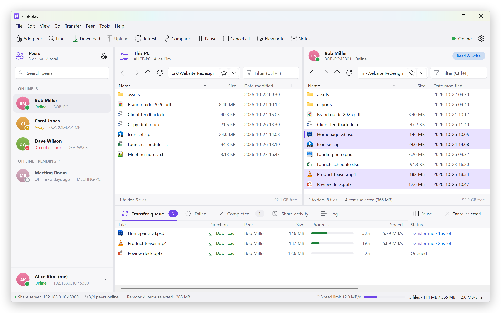
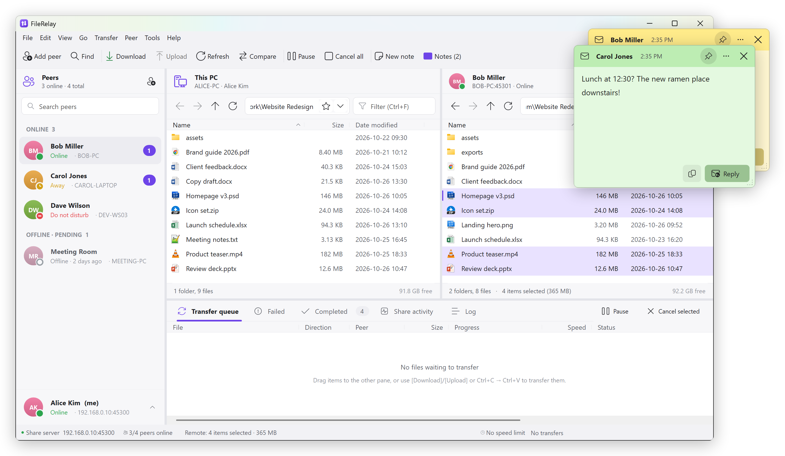
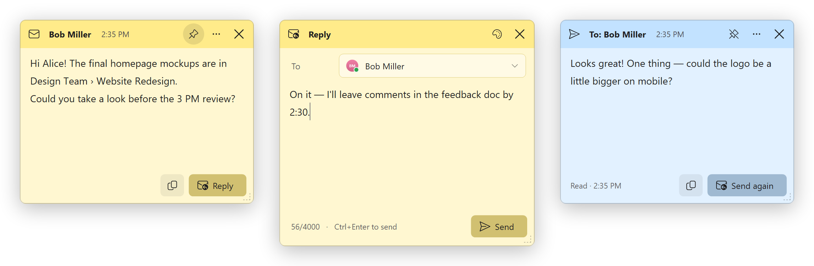
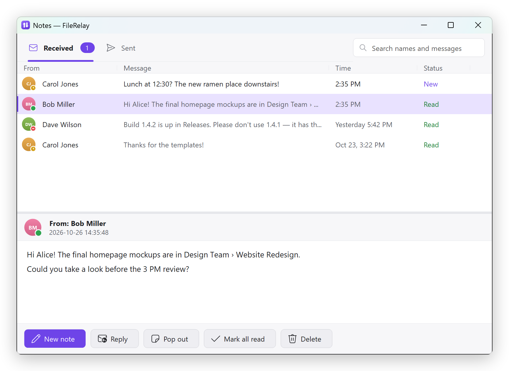
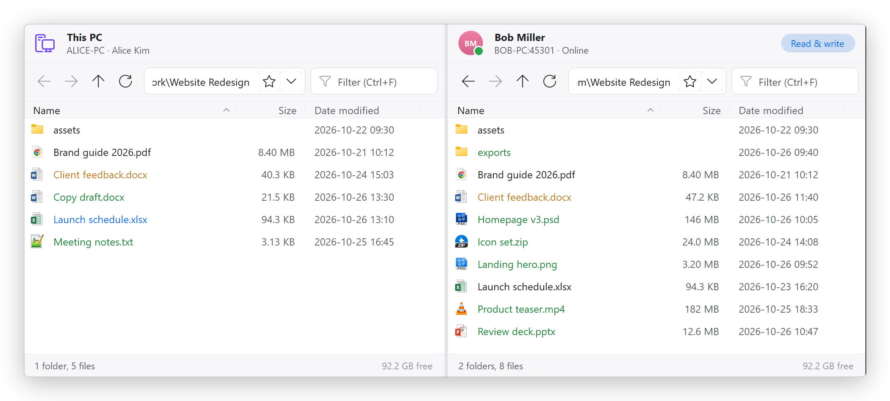
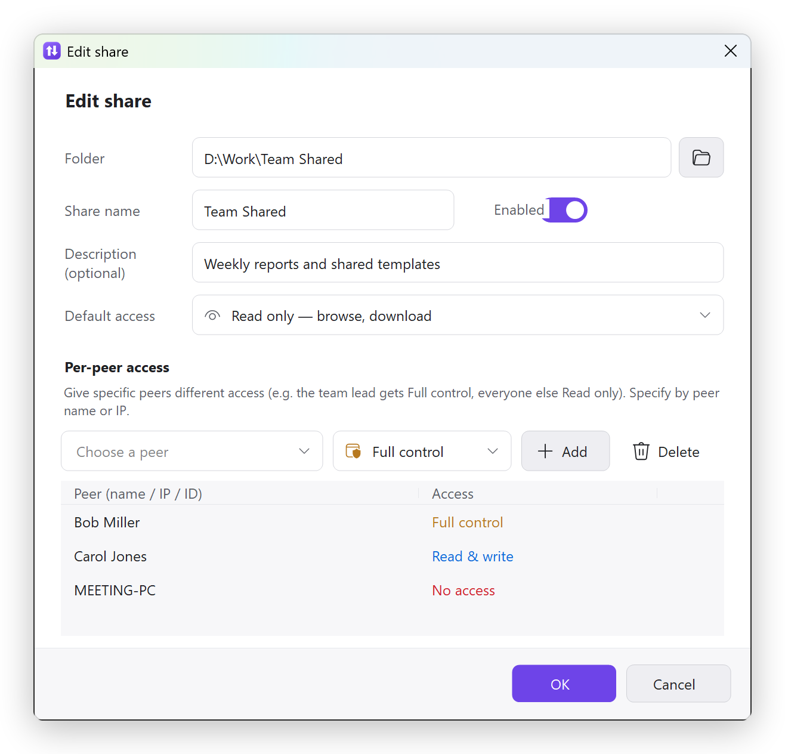
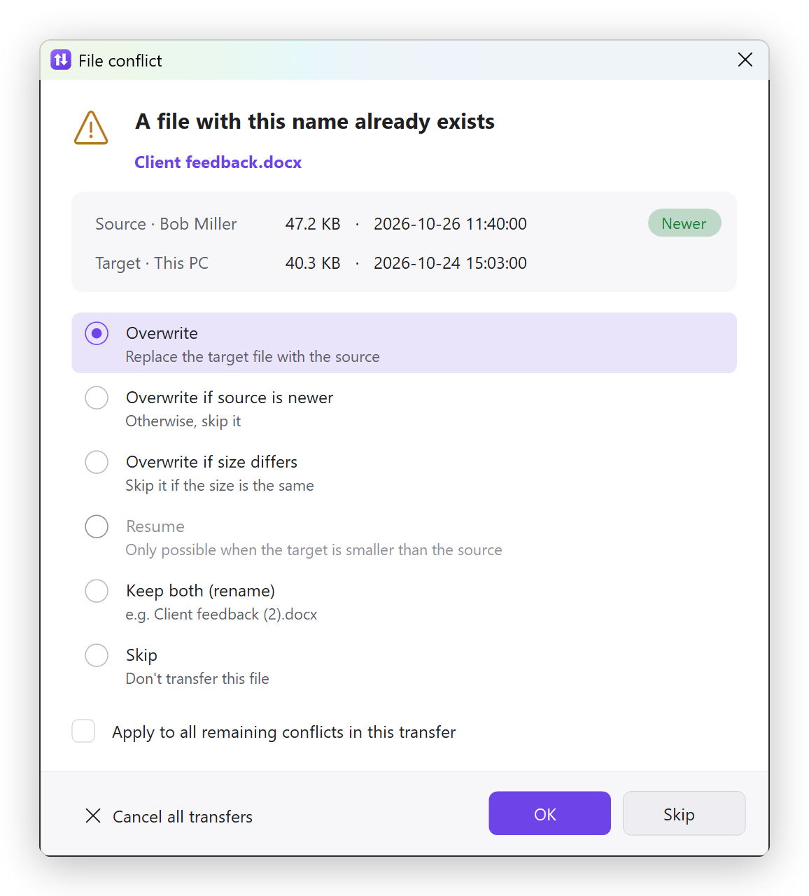
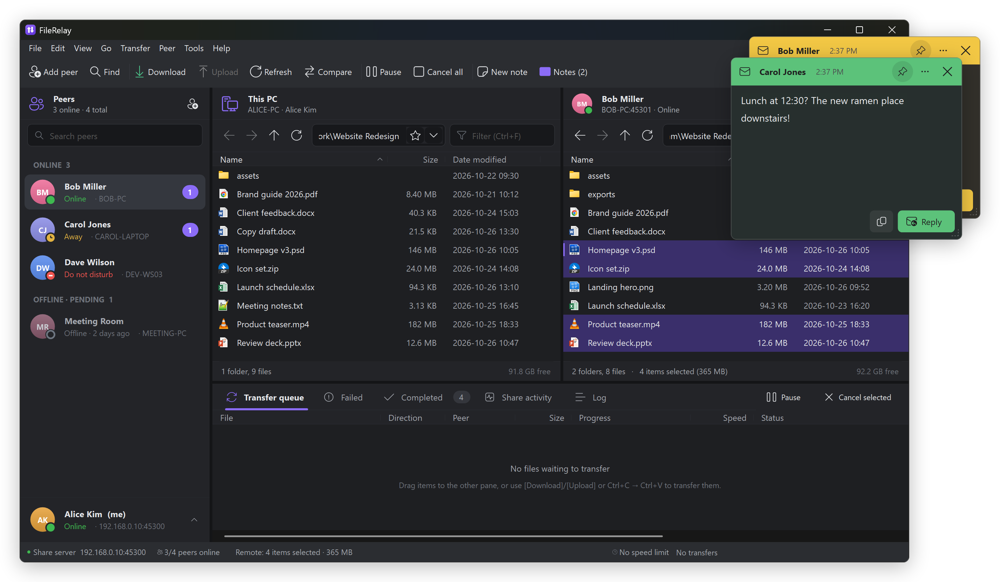

# FileRelay

**English** | [한국어](README.ko.md)

A small resident tool for office LANs: PCs exchange files from **pre-configured shared folders** over HTTP and send each other **sticky-note messages**.
C# WinForms on .NET Framework 4.8 — a single exe, no external libraries, no installer.

<p align="center">
  
</p>
<p align="center"><sub>Peers on the left, <b>This PC ↔ a colleague's share</b> in the middle, the transfer queue at the bottom (downloading from Bob's <i>Design Team</i> share with a speed limit on).</sub></p>

## Features

| Area | What it does |
|---|---|
| Peers | Add a peer by IP (or PC name). If the other PC is running FileRelay, **both sides register each other automatically** and show the name each user registered. When someone adds you, they're added back with a tray notification (or you're asked first — configurable). Status icons (online / away / do not disturb / offline / pending / blocked), aliases, blocking, two-way removal, LAN discovery (UDP). |
| Shares | Folders you choose in advance. Access levels `none / read / write / full` plus **per-peer access**. Files deleted or overwritten by peers go to your Recycle Bin. Hidden files stay hidden; path escapes are blocked. |
| Transfers | FileZilla-style dual pane (This PC ↔ peer). Queue, concurrent transfers, **automatic resume** for downloads and uploads (`.frpart`), pause / resume / cancel / retry, 7 conflict actions with "apply to all", speed limits, preserved modified times, recursive folders, open a remote file and upload it back after editing, folder compare. Nothing is transferred without a user action. |
| Navigation | Back / forward / up (mouse back/forward buttons work), address bar, recent places and quick access, filter, natural sort, Explorer shortcuts, drag and drop (including from Explorer to the remote pane), context menus. |
| Notes | Send a note to an online peer → it pops up on their screen as a **sticky-note window** without stealing focus. Reply, colors, pin (always on top), read receipts, a Notes window (received / sent, search). Notes received in do-not-disturb mode are shown when it ends. |
| Background | Tray icon (unread-note badge), start with Windows, single instance, automatic away. Closing the window asks whether to **keep running in the tray** (default) or quit. |
| History | Activity in your shares (who downloaded / uploaded / deleted what), a log tab and daily log files. |
| Language & look | **English and Korean** (automatic from the Windows display language, or chosen in Settings). Light (default) and dark themes. |

## Sticky notes

Send a short message to a colleague who's online. It doesn't open a chat window — it lands on their screen as a small **sticky note**.

<p align="center">
  
</p>

**Sending**
- Select a peer and click **New note** (Ctrl+M), right-click a peer → **Send note…**, or use **Send note** in the tray menu.
- Type, pick a color with the palette button if you like, and press **Ctrl+Enter**. Choose **All online peers** as the recipient to send the same note to everyone online.
- Notes go to online peers only (up to 4,000 characters, pasted as plain text).

**Receiving**
- The note pops up at the **top right of the screen without taking focus**, so whatever you're typing isn't interrupted. If several arrive, they stack.
- An unread badge appears next to the sender in the peer list, on the **Notes** button and on the tray icon.
- In **Do not disturb**, notes are kept quietly (tray notification only) and pop up when you switch back.

<p align="center">
  
</p>
<p align="center"><sub>Received note → <b>Reply</b> opens next to it in the same color → the sender's copy shows when it was <b>Read</b>.</sub></p>

**On a note**
- **Reply** (Ctrl+R) opens a reply window beside the note. The copy button copies the text.
- The **pin** keeps the note above other windows. **⋯** changes its color, opens the sender's shared folders or the Notes window, or closes all note windows. Esc closes the note.
- Clicking or closing a note marks it as read, and the sender sees **Read** with the time (read receipts can be turned off).

**Notes window** (Ctrl+Shift+M) keeps every note you received and sent: search by name or text, New / Read status, reply, pop a note out again, mark all read, delete.

<p align="center">
  
</p>

**Settings → Notes**: pop up right away or tray notification only, sound, always on top, read receipts, window style (pastel sticky note / dark / follow the theme), default color (7 colors) and how long to keep notes.

## More screenshots

**Folder compare** — **Compare** on the toolbar checks same-named items in both panes:
<b>green</b> = only on this side, <b>orange</b> = different size, <b>blue</b> = newer on this side.

<p align="center">
  
</p>

<table>
  <tr>
    <td width="50%" valign="top"><b>Per-peer access</b> — a share is read-only by default, but Bob gets full control, Carol can add files, and the meeting-room PC doesn't see it at all.</td>
    <td width="50%" valign="top"><b>Same file name</b> — 7 ways to resolve a conflict, with sizes and dates side by side and "apply to all".</td>
  </tr>
  <tr>
    <td></td>
    <td></td>
  </tr>
</table>

**Dark theme** (Settings → Advanced) — note windows follow the theme too.

<p align="center">
  
</p>

## Requirements

- Windows 10 / 11
- .NET Framework 4.8 (included in Windows 10 1903 and later)

## Build

```
build.cmd
```

Or `dotnet build src\FileRelay\FileRelay.csproj -c Release`, or open `FileRelay.sln` in Visual Studio 2019+.
Output: `src\FileRelay\bin\Release\FileRelay.exe` — this single file is all you need to deploy.

> When giving FileRelay to another PC, copy **only the exe**. `FileRelay.jsonc` (settings) and `FileRelay_data\` (peer list, notes, ID) next to the exe
> belong to that PC. Since 1.1.0 a copied data folder gets a new ID on the other PC automatically, but the name (`userName`) in the settings travels with it, so change it.

## Getting started

1. Run `FileRelay.exe`. The first time, it asks for **your name**, the port (default 45200), an optional first shared folder and the language.
2. Enter a colleague's IP in **Add peer** (Ctrl+N). If their FileRelay is running, you appear in each other's lists.
   On the same subnet you can also pick running PCs with **Find on network**.
3. Click a peer on the left to see their shared folders in the right pane. Transfer with drag and drop, **Download** / **Upload**, or Ctrl+C → Ctrl+V.

> **Firewall**: allow FileRelay when Windows Firewall asks on first run. If other PCs can't connect to you, click the warning in the status bar
> or **Tools > Add Windows Firewall rule…** (administrator rights). It adds a program rule and TCP/UDP rules for the port, for all network profiles.

### Command line

| Argument | Description |
|---|---|
| `--tray` | Start in the tray without a window (used for start with Windows) |
| `--data <folder>` | Settings/data folder — for running several instances on one PC |

## Settings file (JSONC)

- Location: `FileRelay.jsonc` + `FileRelay_data\` next to the exe if that folder is writable (portable), otherwise `%APPDATA%\FileRelay\`.
- Comments (`//`, `/* */`) and trailing commas are allowed. Using the **Settings** window (**File > Settings…**, Ctrl+,) is recommended; if you edit the file directly, the running app reloads it automatically (port changes included). Only language, theme and font changes need a restart.
- The peer list, notes and window state are not in the settings file but in the data folder (`peers.json`, `notes.json`, `state.json`, `logs\`).

```jsonc
{
  "userName": "Alice",
  "port": 45200,
  "language": "auto",        // auto (Windows display language) | en | ko
  "theme": "light",          // light | dark
  "shares": [
    {
      "name": "Team",
      "path": "D:\\Share\\Team",
      "access": "read",                        // default: read only
      "peerAccess": { "Bob": "full",           // full control for this peer only
                      "192.168.0.15": "none" } // hidden from this PC
    }
  ]
}
```

### Share access levels

| Level | Allowed |
|---|---|
| `none` | The share is not visible to that peer |
| `read` | Browse, download |
| `write` | + upload (new files), new folders, resume uploads — **no** delete / overwrite / rename ("copy only") |
| `full` | + delete, rename, overwrite |

## Translations

UI text lives in `src/FileRelay/Lang/en.json` and `ko.json` (flat `"key": "text"` pairs, embedded in the exe).
To fix a translation without rebuilding, put a `lang\en.json` (or `ko.json`) next to the exe containing only the keys you want to override.
`python tools/i18n_check.py` checks that every key used in the source exists in both languages, that both files have the same keys and placeholders, and lists leftover hard-coded strings.

## Keyboard shortcuts

| Keys | Action |
|---|---|
| Enter / double-click | Open folder or file (remote files are downloaded to a temp folder and opened) |
| Backspace, Alt+↑ | Parent folder |
| Alt+← / Alt+→, mouse back/forward | Back / forward |
| F5, Ctrl+R | Refresh |
| Ctrl+L, Alt+D, F4 / Ctrl+F | Address bar / filter |
| Ctrl+C / Ctrl+V | Copy / paste (pasting into the other pane transfers) |
| Ctrl+T, Ctrl+Enter | Transfer the selection to the other pane |
| F2 / Delete / Ctrl+Shift+N | Rename / delete / new folder |
| Tab | Switch between the local and remote panes |
| Ctrl+N / Ctrl+M / Ctrl+Shift+M | Add peer / write note / Notes |
| Ctrl+P / Ctrl+, / F1 | Pause transfers / settings / shortcut help |

## Protocol (for maintainers)

A `TcpListener`-based HTTP/1.1 server (HttpListener is not used because binding to external addresses needs administrator rights). Every request carries `X-FR-Id / X-FR-Name / X-FR-Port / X-FR-Status / X-FR-Key` (group key hash) headers. Errors are returned as a code plus arguments, so each side shows them in its own language.

| Method | Path | Description |
|---|---|---|
| GET | `/api/hello` | Public info (name, ID, port) |
| POST | `/api/register` · `/api/unregister` · `/api/ping` · `/api/goodbye` | Peer relationship / heartbeat |
| GET | `/api/shares` · `/api/list` · `/api/walk` · `/api/stat` | Browse shares (mutually registered peers only) |
| GET | `/api/file` (+`Range`) | Download (resumable) |
| PUT | `/api/file?offset&total&mode` | Upload — written to `.frpart`, swapped in when complete |
| POST | `/api/mkdir` · `/api/rename` · `/api/delete` · `/api/discard` | File operations (access checked) |
| POST | `/api/note` · `/api/note/read` | Notes / read receipts |

LAN discovery uses UDP broadcasts on the same port (`FRDISC1` / `FRHELLO1`).

## Tests

Headless end-to-end test — starts two nodes and checks pairing, integrity, resume, conflict policies, access levels, path escapes, pause/cancel, notes, IDs, settings round-trips and both languages:

```
dotnet build tests\FileRelay.Tests -c Debug
tests\FileRelay.Tests\bin\Debug\FileRelay.Tests.exe e2e %TEMP%\fr_e2e
```

Peer list repaint check — with one online and one unreachable peer, the idle list must not repaint during heartbeats, and a change to one peer must redraw only that row (screenshots are saved to `<workdir>\shots`):

```
tests\FileRelay.Tests\bin\Debug\FileRelay.Tests.exe paint %TEMP%\fr_paint 20
```

README screenshots — starts three demo peers (plus one offline), browses, downloads and exchanges real notes, and captures each window (they appear on screen for about a minute). The work folder (`D:\Work` below — it must be empty or a previous demo folder) shows up in the local pane. Then `tools/readme_images.py` (Pillow) rounds the corners, adds shadows and writes `docs/images/<en|ko>/`:

```
for %l in (en ko) do for %t in (light dark) do tests\FileRelay.Tests\bin\Debug\FileRelay.Tests.exe readme D:\Work %TEMP%\fr_shots\%l-%t %l %t
python tools\readme_images.py %TEMP%\fr_shots
```

## Project layout

```
src/FileRelay/
  Core/       settings (JSONC), models, stores, logging, i18n, AppCore (service hub), shell operations
  Lang/       en.json, ko.json (embedded UI text)
  Net/        HTTP server, API routing, API client, peer service, LAN discovery
  Transfer/   transfer queue/workers, job building, local and remote file systems
  UI/         themes, icons, main window, file panes, peer list, bottom panel, tray
  UI/Controls owner-drawn list view, buttons, text boxes, selects, toggles, tabs
  UI/Dialogs  settings, message/input, conflicts, add/find peer, first run, about
  UI/Notes    sticky-note windows, compose, Notes window
tests/FileRelay.Tests/  e2e tests, screenshot harnesses (UI check, README)
tools/                  icon generator, i18n merge/check scripts, README image builder
docs/images/            README screenshots (en, ko)
```

## License

[MIT](LICENSE) © 2026 Soo-Hwan Cho (Splendidz)
